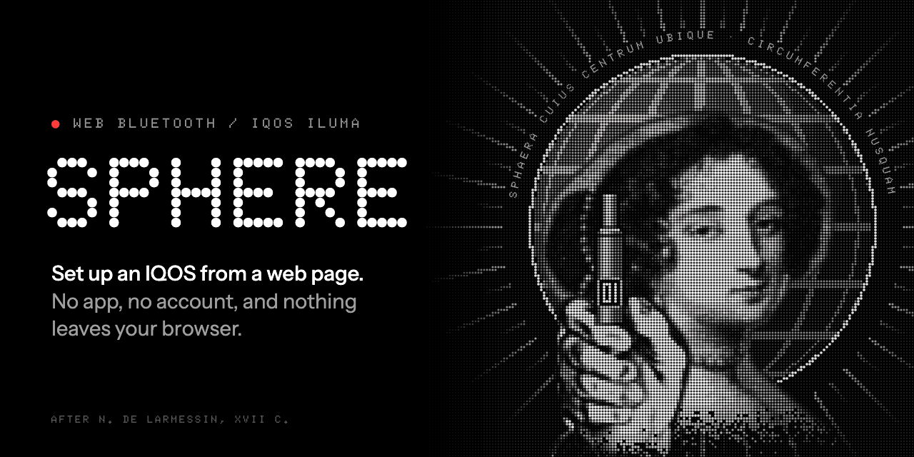

# Sphere

<p align="center">
  
</p>

Control an IQOS ILUMA from a web page over Bluetooth. Sphere is the browser
counterpart of [`iqos_cli`](https://github.com/V-VX/iqos_cli): the same
operations, as a settings app. Each setting comes with a picture, a short
guide, and its controls.

It is a static site. There is no server, no account and no telemetry, and the
page's own security policy forbids it from making network requests.

The protocol layer is a port of the [`iqos`](https://github.com/V-VX/iqos)
crate, checked byte for byte against that crate's test vectors and against
frames captured from an ILUMA i. See [Verification](#verification).

## Run it

```bash
pnpm install
pnpm dev        # http://localhost:5173
```

Open the page in Chrome, Edge or Opera (desktop or Android), or in Bluefy on
an iPhone or iPad. Wake the device, close the IQOS app, press **Connect a
device** and pick it from the browser's list. The first connection asks the
operating system to pair.

To publish, run `pnpm build` and upload `dist/` to any static host that serves
HTTPS. Web Bluetooth only works on a secure origin. See
[Deploying](#deploying) for the host this repository is set up for.

## The page

Connected, the page shows the device and its settings.

- **The device card** draws the connected model in dots, filled to its
  battery level, with the model, firmware and the rest under **Details**.
  Each supported model has its own drawing: one body or a holder with a
  charger, a wrap on the PRIME models, a screen on the ILUMA i series.
- **Each setting** is a section of its own: an animated dot picture that
  follows the setting's current value, a guide to what the setting does, and
  under them the switch or choice. Settings the device reports follow the
  device; the two it does not report (Smart gesture and lock) mark nothing
  until you choose, then show what was last set here.
- **Supported models** on the start page shows each model's drawing.

**Languages.** The page speaks English, Japanese, Chinese (simplified and
traditional), Korean, Russian and Italian. It opens in the browser's language
when it has it and in English otherwise; the switch in the top bar changes it
and the choice is kept. A link can ask for one: `?lang=ja`, with the codes
`en`, `ja`, `zh-Hans`, `zh-Hant`, `ko`, `ru` and `it`. Link previews and search
results stay English, because the address is the same for every language.
The translations have not been read by native speakers yet
([Backlog](Backlog.md)).

The outcome of a click appears as a short notice at the bottom of the page.
There is no console. For a bug report, **Details → Copy session log** copies
what each control sent and every frame that came back.

The pictures are Sphere's own, drawn by code in `src/ui/scenes.ts`. No image
is downloaded or shipped.

## Commands

The page has no prompt, but every control still runs one of `iqos_cli`'s
commands through `app.run(line)`, and the session log records them. This is
the vocabulary:

| Command | What it does | Models |
|---|---|---|
| `battery` | Battery level | all |
| `info` | Model, firmware, product numbers, battery voltage | all |
| `diagnosis` | Puff count, days used, battery voltage | all |
| `lock` / `unlock` | Lock or unlock the device | all |
| `findmyiqos` | Vibrate until Enter is pressed | all |
| `brightness [high\|low]` | Show or set LED brightness | all |
| `vibration [<flag> on\|off ...]` | Show or set vibration flags: `heating`, `starting`, `puffend`, `terminated`, `charge` | all; `charge` on holder models |
| `smartgesture enable\|disable` | Toggle Smart Gesture | all but ILUMA ONE |
| `autostart [on\|off\|status]` | Show or toggle Auto Start | ILUMA i series |
| `flexpuff [enable\|disable\|status]` | Show or toggle FlexPuff | ILUMA i, i PRIME |
| `flexbattery [performance\|eco\|pause on\|off]` | Show or set FlexBattery | ILUMA i, i PRIME |
| `device list\|save <label>\|remove <label>` | Manage saved device labels | |
| `help`, `version` | | |

Commands a web page needs and a process does not (the first four are what the
connect buttons and the model tiles run):

| Command | What it does |
|---|---|
| `connect` | Open the browser's device list, filtered to IQOS |
| `connect <label>` | Reconnect to a saved device |
| `connect --last` | Reconnect to the most recent device |
| `connect --all` | List every nearby device, for names Sphere does not expect |
| `model <model>` | Say which model this is when its name does not |
| `refresh` | Read every setting again |
| `disconnect`, `exit`, `quit` | Close the connection |
| `lang [code]` | Show the page's language, or choose one |
| `clear` | Clear the recorded output |

### Differences from the CLI

- **Bluetooth only.** There is no `--usb`.
- **The browser picks the device.** `--model` and `--timeout` have no
  equivalent: the browser's chooser does the scanning, and a page cannot
  connect to a device the user did not pick.
- **Saved labels hold a browser id, not an address.** Browsers do not reveal
  Bluetooth addresses. The id is opaque and specific to this site.
- **No serial number.** Browsers refuse to read that characteristic (it is on
  the Web Bluetooth blocklist), so `info` shows `hidden by the browser`.
- **Newer wire handling.** Sphere follows the current upstream `iqos` code
  rather than the revision `iqos_cli` 1.0.1 pins: frames are checked for
  length and CRC both ways, long frames are split into 20-byte writes, and
  every write waits for the device's reply. Three frames whose checksum is
  wrong in the pinned revision (Smart Gesture on/off, FlexPuff off, and the
  lock confirmation) carry the corrected CRC-8 here.
- **Diagnosis numbers carry a warning.** `diagnosis` and the battery voltage
  in `info` are decoded the way `iqos_cli` 1.0.1 decodes them. Upstream has
  since stopped attributing units to those bytes, so Sphere shows them marked
  as unverified.

## Privacy and security

- **No network.** The built page ships a Content-Security-Policy with
  `default-src 'none'` and `connect-src 'none'`. Scripts, styles and fonts
  come from the page's own origin; nothing else loads, and `fetch` is blocked
  by the browser. An end-to-end test asserts this, in every language.
- **One third-party library at runtime.** [i18next](https://www.i18next.com/)
  looks up the page's words. It has no dependencies of its own and touches
  neither the network nor the page; a test holds `package.json` to that one
  name. Everything else in the bundle is this repository's code.
- **Little is stored.** `localStorage` holds saved labels, the last device (a
  browser-scoped id, the advertised name and the model) and the language you
  chose. Serial numbers, product numbers, usage counters and the session log
  are never written.
- **Nothing a device says becomes markup.** All text reaches the page as text
  nodes; the policy also sets `require-trusted-types-for 'script'`, so an
  `innerHTML` slipping in later would fail loudly.
- **Frames are checked before they are believed.** Length, CRC and the
  device-error flag are validated on every reply, replies are matched to the
  request that asked for them, and reassembly is bounded.
- **Explicit consent per device.** A page can only talk to a device the user
  chose in the browser's own dialog.

`public/_headers` carries the header-only parts of the policy
(`frame-ancestors`, `Permissions-Policy`, HSTS and friends) for hosts that
read that file, such as Cloudflare Workers, Cloudflare Pages and Netlify. On
other hosts, set the same headers in the server configuration.

## Deploying

The site is served from `sphere.h1ka.ru` by Cloudflare Workers as static
assets: files only, with no Worker script in front of them. `wrangler.jsonc`
says what is uploaded (`dist/`) and where it is served (that one domain, with
the `workers.dev` and preview addresses switched off, so the site has a single
origin).

Cloudflare builds and deploys each push to `main` (Workers Builds, connected
to this repository):

| Setting | Value |
|---|---|
| Build command | `pnpm build` |
| Deploy command | `npx wrangler deploy` |

Builds for other branches stay off: a branch whose deploy command is
`wrangler deploy` would replace the live site. `.node-version` and the
`packageManager` field pin Node.js and pnpm for the build. To deploy by hand
instead: `pnpm build && pnpm dlx wrangler deploy`.

Cloudflare does not wait for the tests. Its build stops on a type error, but
a push whose tests fail on GitHub (see [Verification](#verification)) is
deployed all the same.

The security policy allows scripts from the site's own origin only and no
network connections at all, so anything Cloudflare adds to the page either
breaks or breaks the promise that nothing leaves the browser. Two things keep
the page as it was built:

- `public/_headers` sends the page with `Cache-Control: no-transform`.
  Cloudflare leaves such a response alone. Without it, Bot Fight Mode's
  JavaScript detections add an inline script to the page, which the policy
  refuses to run and the console reports on every visit. Bot Fight Mode is a
  setting of the whole zone and cannot be switched off for one hostname, so
  the header is what keeps it away from this site. The cost is that
  Cloudflare does not compress the page either (8 kB instead of 2 kB);
  scripts, styles and fonts are unaffected.
- Web Analytics (automatic setup), Rocket Loader and Email Address
  Obfuscation stay off or have nothing to act on.

`index.html` carries Open Graph tags for sites that show a link as a card.
They name the page and its picture (`public/social-preview.png`) by their full
addresses on `sphere.h1ka.ru`, because the site showing the card fetches them
from outside. A test holds those addresses to the domain in `wrangler.jsonc`,
so serving the site somewhere else means changing both.

The zone has **Always Use HTTPS** switched on, so that an `http://` link
lands on the secure origin instead of a page that cannot use Bluetooth.

After a deployment, check the real thing:

```bash
SPHERE_URL=https://sphere.h1ka.ru pnpm e2e
```

This runs the production-build tests against the deployed site, plus checks
that only a real host can answer: every header in `public/_headers` arrives
with the page and with its files, the host has added no script of its own,
and plain HTTP is sent on to HTTPS.

## Releasing

The version the page shows is the `version` field of `package.json`, read
when the site is built. It changes only when that field does:

```bash
npm version patch -m "chore: release v%s"   # or minor, or major
git push --follow-tags
```

`npm version` edits `package.json`, commits it and tags the commit `v0.1.1`.
The push to `main` makes Cloudflare deploy a site that shows the new version.
The tag starts `.github/workflows/release.yml`, which checks that the tag
names the version in `package.json`, runs `pnpm check`, and then publishes a
GitHub Release with notes generated from the commits since the last one.

## How it is built

```
src/
  protocol/    SCP framing (CRC-8, CRC-16, fragments), command builders,
               response parsers, model capability matrix. Pure functions.
  transport/   session.ts        request/response over any notify channel
               web-bluetooth.ts  the only code that touches navigator.bluetooth
  device/      iqos.ts           typed operations, same sequences as the crate
  console/     the command grammar the controls speak
  storage/     saved device labels
  app/         connection lifecycle, command queue, immutable state store
  i18n/        the languages: which one to use, and a dictionary for each.
               Touches no DOM; i18next is used here and nowhere else
  ui/          DOM rendering; reads state, calls app.run(line)
               view.ts     binds the page: notices, focus, redraws
               panes.ts    the device card and the start page's lists,
                           state in, nodes out
               settings-pane.ts  each setting: picture, guide, controls
               pane-parts.ts     the rows, switches and choices they share
               dots.ts     dot-matrix screens and the timer that moves them
               scenes.ts   the pictures: globe, each model, each setting
               log.ts      the session log as text
               static.ts   the words written into index.html
               language.ts the language switch
tools/fonts/   makes the fonts for languages not written in Latin letters
```

Every control goes through one path, `app.run(line)`, so each action has a
single implementation. Nothing above `ui/` touches the DOM.

TypeScript, Vite, no framework and one runtime dependency, i18next. The
production build is about 42 kB of JavaScript and 4 kB of CSS gzipped, plus
two fonts (36 kB together), all served from the page's own origin. That is
what an English or Italian visitor loads. Another language adds its
dictionary (about 5 kB gzipped) and its two fonts: 8 kB for Russian, 43 kB
for Korean, 76 kB for Japanese, 98 kB for simplified and 115 kB for
traditional Chinese.

The words live in `src/i18n/messages/`, one file a language, checked against
the English one for the same keys and parameters. A line the page shows in a
notice carries its message as well as its English text, so the notice is in
the page's language while the session log stays English. The fonts for each
language hold only the characters its dictionary uses; [docs/fonts.md](docs/fonts.md)
says how they are made and when to rebuild them.

The stylesheet's opening comment describes the visual system: black, white
and one red; square edges throughout; a dot-matrix face for names, figures and
labels. The page sets no inline styles, so `style-src 'self'` holds.

## Verification

```bash
pnpm typecheck   # strict TypeScript
pnpm test        # unit and DOM tests (Vitest)
pnpm coverage    # the same, with coverage thresholds
pnpm e2e         # Playwright, in a real browser
pnpm check       # all of the above
```

`pnpm e2e` uses Playwright's Chromium (`pnpm exec playwright install chromium`
once). To use an installed Google Chrome instead: `PW_CHANNEL=chrome pnpm e2e`.
With `SPHERE_URL` set it tests a deployed site instead of building one: see
[Deploying](#deploying).

GitHub Actions runs `pnpm check` on every push to `main` and on every pull
request (`.github/workflows/ci.yml`).

What the tests establish:

- Every command frame matches the `iqos` crate's constants byte for byte, and
  every frame passes its own CRC and length check.
- Response parsers accept frames captured from an ILUMA i and reject malformed
  ones.
- The session layer matches replies to requests, survives fragmented,
  corrupt, unsolicited and missing replies, and never interleaves requests.
- The Web Bluetooth adapter is driven through a fake GATT stack: chooser
  filters, reconnection, the blocked serial number, dropped links.
- Every picture is a pure function of position and time, tested as one: each
  model draws differently, and each guide picture follows its setting.
- In a real browser, on desktop and phone viewports: the security policy
  holds, no request leaves the origin, and stored or typed text is never
  rendered as markup. The device flows run by mouse and by keyboard.
- Every language has every message, with the same parameters, and its fonts
  hold every character it uses. In a real browser each language fits the
  screen, and changing language keeps the device connected.

The guides describe the settings as IQOS's own published help describes them
(session counts, the eight-minute pause, up to four extra puffs). Those
details can differ by model and market.

## Browser support

| Browser | Works |
|---|---|
| Chrome, Edge, Opera on Windows, macOS, Linux, ChromeOS, Android | yes |
| [Bluefy](https://apps.apple.com/app/id1492822055) on iOS and iPadOS | yes |
| Firefox, Safari, the other browsers on iOS and iPadOS | no Web Bluetooth |

Safari has no Web Bluetooth, and nearly every browser on iOS and iPadOS runs
on Safari's engine. Bluefy is a browser that adds Web Bluetooth itself.
IQOS's own support sends iPhone users to it for the IQOS web app.

On Linux, Chrome needs BlueZ 5.41 or later.

## License and credits

Sphere is free software under the [GNU General Public License v3.0](LICENSE).
Its protocol layer is a port of the GPL-3.0 [`iqos`](https://github.com/V-VX/iqos)
crate, and its command set follows [`iqos_cli`](https://github.com/V-VX/iqos_cli).

Two typefaces set the Latin text: *Doto* (names, figures and labels) and
*Instrument Sans* (sentences). The other scripts use faces made for Sphere
from *Fusion Pixel* (labels, redrawn as dots), *Noto Sans* JP, SC, TC and KR,
and *Geist* (sentences). All are under the SIL Open Font License 1.1. Their
licences are in [`public/font-license.txt`](public/font-license.txt), which
ships with the site and is linked from the page footer.

Sphere is not affiliated with or endorsed by Philip Morris International. IQOS
and ILUMA are their trademarks.
